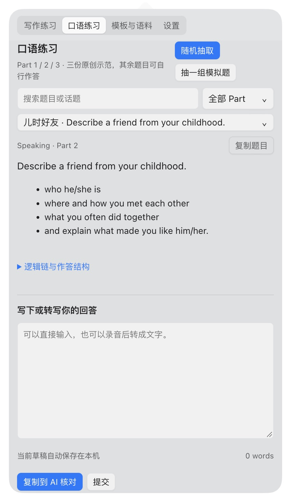
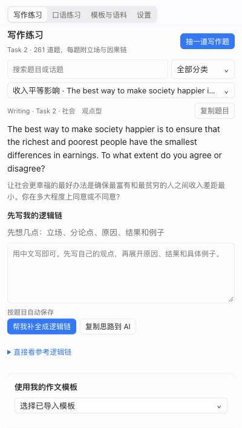
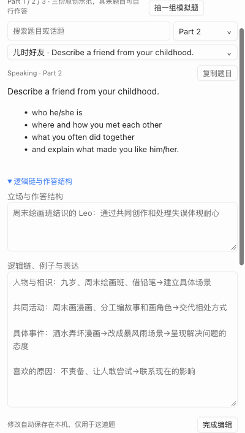
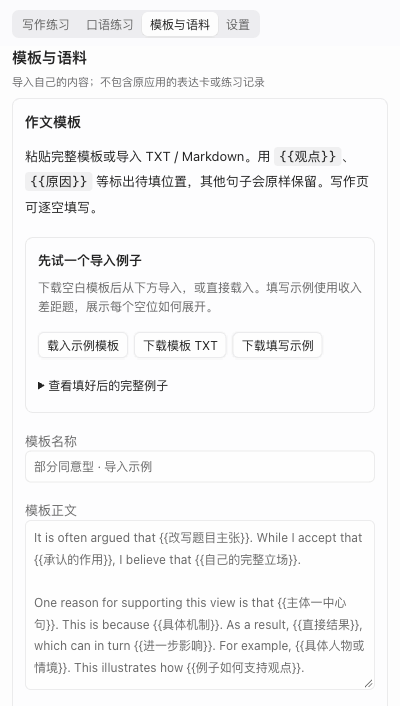
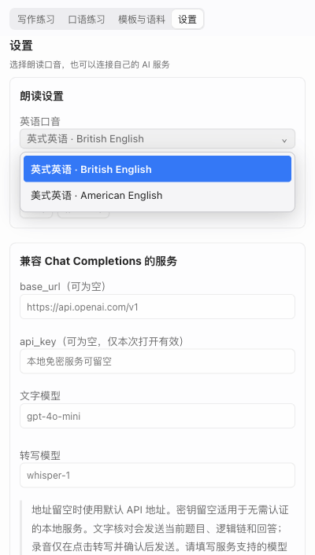
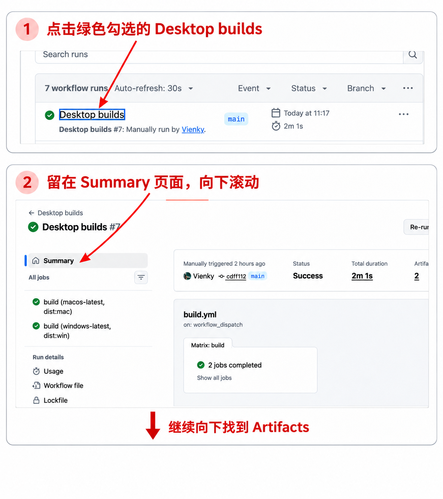
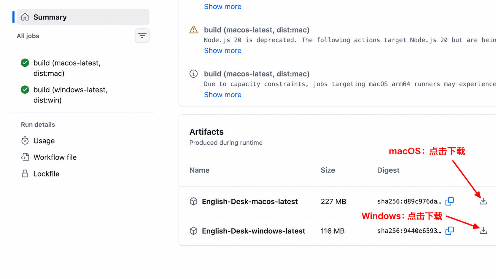
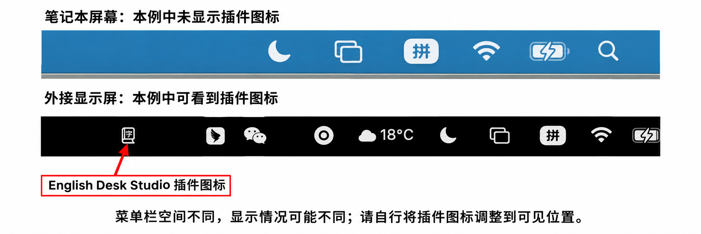
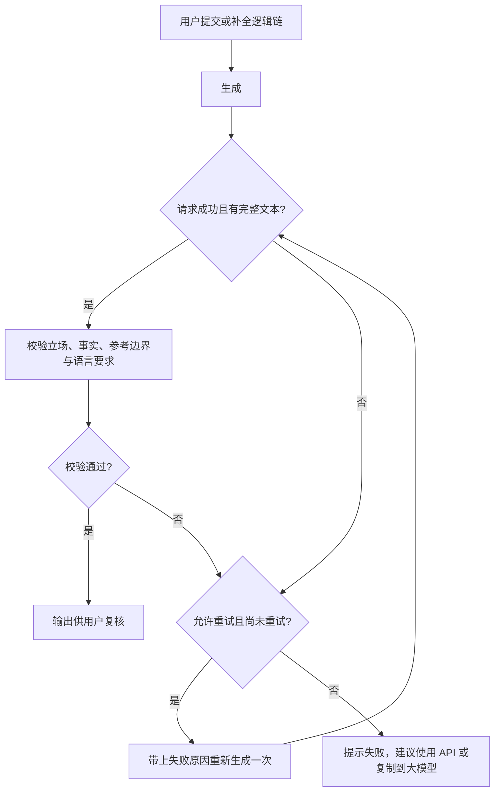

<p align="center">
  
</p>
<h1 align="center">English Desk Studio</h1>
<p align="center">雅思写作与口语练习插件 · macOS 菜单栏 / Windows 系统托盘</p>
<p align="center">
  <a href="https://github.com/Vienky/English_Desk/actions/workflows/build.yml"></a>
  
  
</p>
<p align="center">
  <a href="#下载安装">下载安装</a> ·
  <a href="#界面预览">界面预览</a> ·
  <a href="#功能">功能</a> ·
  <a href="#如何摸鱼食用">如何摸鱼食用</a> ·
  <a href="#开发与构建">开发与构建</a>
</p>

启动后常驻 macOS 菜单栏或 Windows 系统托盘，点击图标就能展开练习面板。抽一道题、先写自己的逻辑链，再查看参考和写下回答。口语支持录音、转写和英美发音朗读；作文支持导入自己的模板并逐空填写。不配置 API 也可以练习，或者把题目和回答一键复制到 AI 核对。

**口语题库目前已更新至 2026 年 9–12 月题库。**

**目前内置的参考答案、逻辑链和作答结构均为 GPT-6-Astra 编写的参考范例。不保证内容准确，也不保证符合雅思考试要求，仅供参考。** 用户自行修改或通过本地模型、API 新生成的内容不属于这批内置范例。

## 版本与更新

### 2026-11-03

| 版本 | 本版内容 |
| --- | --- |
| **0.2.8** | 修复 Windows 面板背景过于透明；设置新增清晰背景和轻微透明选项，Mac 保留磨砂玻璃选项。 |
| 0.2.7 | 合并 API 服务商预设、模型列表与密钥保存功能，保留自动更新。 |
| **0.2.6** | 新增自动检查更新；Windows 支持后台下载后重启安装，Mac 提供新版下载入口；图片改用明确的仓库链接。 |
| 0.2.5 | 写作题库按题型与主题去重，从 261 道精简至 130 道，保留 6 种题型与全部主题分类。 |
| 0.2.4 | 全部内置逻辑链统一为单段箭头形式，例子与表达默认折叠；API 与复制提示词同步改为简短逻辑链。 |
| 0.2.3 | 未连接模型时，补全逻辑链按钮明确提示并提供设置入口，不再自动复制；更新记录按日期分组。 |
| 0.2.2 | 单词导入移至设置，背词页右下角增加入口；新增精通评分，每月复习一次。 |
| 0.2.1 | 补全 Windows 通知所需的应用标识；明确 Intel Mac 安装包名称；背词页底部说明移到设置的开源许可。 |
| 0.2.0 | 新增 7,298 词背词卡片、自定义每日新词数量、间隔复习、JSON/CSV/TXT/TSV 导入和可关闭的每日提醒；推荐 API，新增生成→校验→失败重试流程与提示词说明；本地 4B/8B/9B 仅手动部署。 |
| 0.1.3 | 菜单栏/托盘练习面板、写作逻辑链、口语逐题录音与可编辑参考、模板和语料导入。 |

**推荐通过 API 接口核对和补全内容。** 不配置 API 时可复制到大模型；本地模型是可选方案，安装应用不会下载或启用模型。

## 背单词


在顶部选择 **背单词**，先回忆词义再点 **显示答案**。点击 🔊 朗读当前单词，口音跟随设置中的英式／美式选择。按重来、困难、记得、简单、精通安排下次复习。按钮名称可以在学习设置的 **评分按钮名称** 里自己改，也可以一键换成「新学 · 眼熟」：第一次见到的新词，「重来」显示为「新学」（以前没见过、看了答案才知道），「困难」显示为「眼熟」。名称只影响显示，不改复习安排。精通按自然月安排，下一月无对应日期时取月末；再次选择精通仍是一个月后复习。其他评分按记忆程度调整间隔；默认每天 20 个新词，可调整为 1–500 个；新词第一次就选精通视为熟词，不占当天新词数量，学完后也可再加学 10 个；认识的词不必翻面，正面即可直接按精通（J）。到期复习不占新词数量，学习进度保存在本机。重来后再次出现：固定倍数约 1 分钟；FSRS 和 SM-2 约 10 分钟，中间先学别的词，免得刚看过答案就考。页面顶部显示等级：按已掌握的词数（下次复习间隔 21 天以上）从 Lv.1 初来乍到到 Lv.33 词库通关，共 33 个称号，分为起步、入门、基础等 10 个阶段，相邻两级最多相差 400 词，达到后不会降级，点击等级可查看全部等级划分；卡片顶部显示今日进度：学会的单词对照今日数量，标记的熟词按 10、20、50… 分档显示。

**按级别学**：内置词库按 CEFR 级别从易到难排列（A1 785 个、A2 1039 个、B1 1465 个、B2 2127 个、C1 1608 个、C2 274 个），每张卡片标有级别。在学习设置的 **新词级别** 里可以从 A2、B1、B2 或 C1 开始，低于所选级别的新词会跳过，已学的词照常复习；雅思 6.5–7 分的词汇大致在 B2–C1。

**生义例句**：每个词除第一个以外的词义都配有一句用这个意思的例句（AI 编写并经审核），生义卡上显示在英文释义下面，普通卡片在「更多」里跟在对应的英文释义后面。

**例句高亮**：例句里会高亮这张卡考的用法（单词或搭配，认得时态、单复数和代词替换），译文里高亮对应的中文意思，一眼看出在句子里怎么用。

**卡片背面**：例句下面列出常用搭配和用法提示；点 **更多** 可看每个词义的英文释义和第二条更接近雅思写作的例句，展开后之后的卡片也保持展开。生义卡显示这个词义的英文释义和相关搭配（按中文释义匹配，拿不准的不显示）。

**搭配卡**：觉得哪个搭配写作或口语用得上，翻面后点一下或按 **1–6**（数字布局为 Z C V B N M）收藏，它会单独成卡：正面是中文和单词（如「缴纳罚款 · fine」），你要说出英文 pay a fine，背面显示答案和用上这个搭配的例句，翻面后朗读读出整个搭配。词库例句没用上这个搭配时（约四分之三的搭配），显示随应用提供的 AI 例句（预先生成，经程序检查确实用上了这个搭配，并由另一个模型逐条审核），标为「AI 例句」，可点「换一句」用你在设置里配置的 AI 重写；极少数没有预先生成的，收藏时会自动写一句，没配置 AI 时卡片会说明。如果在「模板与语料」里导入了自己的 TXT / Markdown 语料（例如自己整理的真题阅读、听力原文），搭配卡会优先显示语料里真正用到这个搭配的原句（最多两句，标「原文」和文件名），查词时也会附一句原句；语料只在本机使用，不随应用分发。和生义卡一样，收藏就算今天学的新词，过一会儿第一次回想（固定倍数约 1 分钟，FSRS 和 SM-2 约 10 分钟）；再按一次或在搭配卡上按 X 取消收藏。用法提示不必专门记，复习时扫一眼即可。

**点词查词**：卡片背面搭配和例句里的英文单词都可以点（还没学过的搭配词下面有虚线），会在下面展开它的级别、学习情况和词义。还没学的词可以点「现在学」，学完自动回到原来的卡片，不受新词级别限制；也可以点「排到新词最前面」。词库里没有的词，配置了 AI 时可以点「用 AI 解释」。搭配那一行点英文是查词，点中文或按 1–6 是收藏。键盘上翻面后按 **K** 逐个打开没学过的词（搭配里的优先），**L** 现在学，**P** 排到新词最前面，Esc 关闭。

**熟词生义**：答案按词性分行，常用义在前，后面的往往是生义（如 pupil 除了「小学生」还有「瞳孔」）。不认识的词义点一下，或翻面后按 **Q / W / E** 把第一、二、三个词义标为 **生义**，以后复习时会高亮，单词正面也会提示「有生义」，提醒翻面前先回想；再按一次或再点一下取消。标为生义的词义会**单独成卡**，按新词学习（占当天新词数量），有自己的复习进度。标记时就算你今天学了它、这次没答上（记一次「重来」），大过一会儿（固定倍数约 1 分钟，FSRS 和 SM-2 约 10 分钟）生义卡会出来让你回想；刚学会或刚忘记的词，按精通也只算「简单」，不会直接推到一个月后。比如 pupil 按了精通，只是「小学生」一个月后复习，「瞳孔」照常从新词开始学。生义卡正面会提示想哪个意思，在生义卡上按 X 不再单独练这个生义。也可以在学习设置里把 **生义标记** 改为「按下的是认识的」：这时按 Q / W / E 选你认识的词义，没选的自动标为生义；一个都不按，保持原来的标记。在正面直接按精通时，会短暂列出其他词义，有不认识的按 O 撤销。

复习算法可在背词页切换，默认为上述固定倍数；也可选 **FSRS**（按记忆模型安排复习，可设目标记住率 85% / 90% / 95%）或 **SM-2**（SuperMemo 经典算法，每个词有独立的容易度）。切换算法保留现有进度。快捷键默认为主键位：A S D F 依次为重来、困难、记得、简单，J 为精通；空格或回车显示答案，R 朗读，O 撤销上一次评分（可连续撤销），X 忽略当前单词，翻面后 Q W E 标记生义。按钮上都标有对应按键。默认为素色模式，标题右侧的圆形按钮可切换：素色模式去掉颜色，等级只留文字，今日进度精简为一条细线，不再闪烁或弹出升级提示，适合安静地背。翻面效果可在学习设置中选择「弹起」（默认，单词滑到顶部并轻微回弹）、「直接」（立即跳到顶部）或「静止」（单词始终在顶部，翻面时不移动）。忽略的单词不再出现，也不计入总词数和等级，可在学习设置中恢复。英式与美式拼写（如 aeroplane / airplane）各自成卡，卡片标明拼写类型，并显示另一种拼写及其学习状态；按 L 跳到另一种拼写学习，评分后回到原来的单词。可在学习设置中改用数字 1–5 布局，或逐个重新绑定按键。

点击背词页右下角 **导入单词库**，跳转到设置中的导入区域，选择文件或粘贴内容，支持 JSON、CSV、TXT、TSV。同名单词更新释义并保留复习进度。JSON 示例：

```json
[{"word":"abandon","meaning":"放弃","example":"Do not abandon your plan."}]
```

CSV/TSV 按单词、释义、例句三列排列，例句选填。首行可为 `word,meaning,example`，含逗号的字段用双引号包裹。一次最多 10,000 条、文件不超过 2 MB。

**提醒需要自行设置**：设置 → 背词提醒 → 开启每日提醒 → 选择本机时间 → 保存提醒，并在 macOS 系统设置或 Windows 通知设置中允许 English Desk Studio 通知。提醒默认关闭，只在应用运行时生效；关闭面板不影响，退出应用后不提醒。电脑休眠错过提醒时间不会补发。

内置词库同步于 2026-11-03，采用 Word Atlas contributors 的 CC BY 4.0 词条并精简字段。非官方考试词表，词义和例句可能有误；详见[词库版本及授权](docs/vocabulary-license.md)。

## 界面预览

主界面是点击图标展开的小面板。macOS 使用原生下拉面板与灰白磨砂玻璃背景，点击外部或按 Esc 收起；开启置顶后，点击外部保持展开。

<p align="center">
  
</p>

以下练习截图来自 0.1.3；背词功能见上文 0.2.0 更新。Windows 从系统托盘展开，共用练习功能；窗口外观以 Windows 实际运行效果为准。

<table>
  <tr><th>写作：先写自己的逻辑链</th><th>口语：每题独立展开</th></tr>
  <tr>
    <td></td>
    <td></td>
  </tr>
  <tr><th>参考回答可以编辑</th><th>逻辑链与结构可以编辑</th></tr>
  <tr>
    <td></td>
    <td></td>
  </tr>
  <tr><th>导入自己的模板与语料</th><th>面板内切换英美口音</th></tr>
  <tr>
    <td></td>
    <td></td>
  </tr>
</table>

## 功能

| 功能 | 可以做什么 |
| --- | --- |
| 写作题库 | 130 道 Task 2 题目，每题附立场和两条中文因果链；支持搜索、分类和随机抽题 |
| 口语题库 | 33 张 Part 1 话题卡（198 个问题）、50 张 Part 2 题卡、494 条关联 Part 3 问题；浏览时同 Part 重复题去重 |
| 口语模拟 | 一次抽取三张 Part 1 话题卡、一张 Part 2 题卡和相关 Part 3 追问 |
| 示范与逻辑链 | 三个 Part 各有一份完整原创示范；逻辑链与作答结构可自行编辑，按题目自动保存，可恢复默认 |
| 作文模板 | 粘贴或导入 TXT / Markdown，用 `{{占位名称}}` 留空；填空时保留其他句子 |
| 自定义口语语料 | 导入题目、答案、提示点和逻辑链；支持 JSON、TXT、Markdown |
| Part 1 参考回答 | 每题可添加、编辑和恢复默认，自动保存；朗读使用修改后的答案 |
| 录音练习 | 每题分别展开录音、回放和导出 WebM；配置转写服务后可将录音转成文字 |
| 背词提醒 | 系统通知权限 | 默认关闭，在设置里启用后允许通知；应用需保持运行 |
| 英美朗读 | 在设置中切换英式或美式英语并试听；回答与示范共用所选口音 |
| 自行部署模型 | 可选 Qwen3.5-4B、Qwen3-8B、Qwen3.5-9B；4B 为推荐选项，安装时不启用或下载 |
| AI 核对 | 复制题目与回答到任意 AI；也可通过兼容接口直接核对 |
| 插件面板 | macOS 菜单栏、Windows 通知区域入口；无标题栏浮层，点击外部收起，支持置顶 |
| 本地草稿 | 自动保存当前回答、导入语料和模板，不累计打卡或成绩记录 |

## 面板背景

在设置 → 面板外观中选择背景。Windows 默认使用清晰背景（不透明），桌面图标不会透到文字下面；轻微透明保留少量背景颜色。Mac 另可选择磨砂玻璃。选择后立即生效并自动保存。

## 老板键

在任何应用里按下老板键（默认 ⌥`）会立即收起面板并停止朗读，再按一次打开；面板置顶时同样有效。可在设置 → 老板键中更换组合（需包含 ⌘、⌃ 或 ⌥）或关闭。Mac 上还可选择面板呼出位置：跟随菜单栏图标，或屏幕左侧。
## 标签切换

面板打开时，⌘1–⌘5（Windows 为 Ctrl+1–5）依次切换到写作练习、口语练习、背单词、模板与语料和设置，⌘, 也可打开设置。按住 ⌘ 片刻，标签上会显示快捷键。可在设置 → 标签切换中逐个更换（需包含 ⌘、⌃ 或 ⌥，重复时自动交换）或恢复默认；⌘, 始终打开设置。

## 应用更新

先手动安装一次 **0.2.6 或更高版本**，旧版本无法自行获得更新功能。之后默认启动时及每 6 小时检查 GitHub Releases，可在设置 → 应用更新中关闭或手动检查。

- Windows：发现新版后后台下载，完成后点击 **重启并安装**；不会在练习过程中自动退出。更新包由 electron-updater 校验。
- macOS：自动检查并提示新版，点击 **下载新版** 后下载安装包并替换应用。当前未正式签名，暂不支持静默替换；[Electron 的 Mac 自动更新需要有效签名](https://www.electronjs.org/docs/latest/tutorial/code-signing)。
- 更新不主动删除本机练习数据。联网失败时保留当前版本，可重试或打开下载页面。

## 下载安装

**[下载最新版本安装包](https://github.com/Vienky/English_Desk/releases/latest)**

- **Mac**：Apple 芯片下载文件名带 `arm64` 的 `.dmg`；Intel 芯片下载不带 `arm64` 的 `.dmg`。双击后把应用拖到 Applications，再打开应用。
- **Windows**：下载 `.exe`，双击即可安装并启动，不需要安装 Node.js、Python 或 Ollama。

词库、练习页面和导入功能随安装包提供。朗读使用系统英语语音，提醒需在应用设置中主动开启。大模型属于可选功能，推荐填写 API；无需部署本地模型也可以背词和练习。

当前安装包未购买代码签名或 Apple 公证。macOS 首次打开会提示无法验证开发者：先点 **完成**，再打开 **系统设置 → 隐私与安全性**，在页面下方点击 **仍要打开**，输入密码确认即可，之后可正常打开。Windows 可能提示未知发布者，点击 **更多信息 → 仍要运行**。

<details>
<summary>备用下载：GitHub Actions（仅在 Releases 尚无安装包时使用）</summary>


1. 登录 GitHub，打开 [Desktop builds](https://github.com/Vienky/English_Desk/actions/workflows/build.yml)。点击带绿色勾选的近期构建标题 **Desktop builds**。
2. 在左侧点击小房子图标旁的 **Summary**，进入本次构建总览。
3. 在 **Summary** 页面向下滚动，越过 **Matrix: build** 区块，找到 **Artifacts**。找到 **English-Desk-macos-latest**（macOS）或 **English-Desk-windows-latest**（Windows），点击对应行最右侧的向下箭头下载按钮。旁边的蓝色双框图标用于复制摘要，不是下载。
4. 解压下载的 ZIP，再打开里面的 `.dmg`（macOS）或 `.exe`（Windows）进行安装。macOS 的应用 ZIP 需要再解压一层才能得到 `.app`。

先按步骤进入下载区域：

<p align="center">
  
</p>

找到 Artifacts 后，点击对应系统右侧的下载按钮：

<p align="center">
  
</p>

截图以第 7 次构建演示页面位置；下载时选择近期成功的构建，旧构建不包含之后新增的功能。构建产物有保存期限，过期后需选择新的构建。

</details>

| 系统 | 构建产物 | 安装方法 |
| --- | --- | --- |
| macOS | `English-Desk-macos-latest` | 打开 `.dmg`，把应用拖入 Applications；也可使用 `.zip` 中的应用 |
| Windows | `English-Desk-windows-latest` | 运行 `.exe` 安装程序，按提示完成安装 |

当前安装包未配置开发者签名或 Apple 公证，系统可能显示未验证发布者提示。macOS 安装包的处理器架构以文件名为准；Intel Mac 可按下方开发说明构建 x64 版本。

## 如何摸鱼食用

专为想在上课或上班间隙背两个单词，又怕老师或老板突然路过的朋友食用。点开悄悄学两眼，按 Esc 就可以认真工作.jpg。单词记不记得住看自己。

ps: 老板什么时候回头不归本插件管噢～（免责声明）

安装后直接打开应用即可出现常驻图标，无需安装浏览器扩展。macOS 使用顶部菜单栏入口，Windows 使用任务栏通知区域入口。

### 需要哪些权限

**显示菜单栏或系统托盘图标不需要额外隐私权限。** 安装后启动 English Desk Studio 即可。macOS 由应用创建菜单栏图标；Windows 的托盘显示开关只决定图标是否收进隐藏区域，不是通知授权。当前版本不需要辅助功能、屏幕录制、输入监控、摄像头或完全磁盘访问权限。

| 功能 | 需要什么 | 什么时候使用 |
| --- | --- | --- |
| 菜单栏 / 系统托盘、展开面板、置顶 | 无额外隐私授权 | 应用启动后可用 |
| 口语录音 | 麦克风权限 | 点击开始录音时请求；拒绝后仍可打字练习 |
| 英美朗读 | 系统已安装对应英语语音 | 不使用麦克风，也不需要语音识别权限 |
| 导入模板或语料、导出录音 | 访问你选择的文件或保存位置 | 通过文件选择框操作；若系统提示文件夹访问，按实际位置授权，无需完全磁盘访问 |
| 复制到 AI | 写入剪贴板 | 点击复制按钮时写入；不会读取已有剪贴板内容 |
| API 核对、录音转写 | 能连接你配置的服务 | 主动提交时发送文本；转写确认后发送录音，不调用系统语音识别 |
| 保存草稿、逻辑链与参考回答 | 应用自身的数据目录 | 自动保存，不需要访问其他应用的数据 |

**macOS 录音授权**：第一次点击开始录音时，在系统提示中允许麦克风访问。若之前拒绝，打开 **系统设置 → 隐私与安全性 → 麦克风**，开启 **English Desk Studio**，然后退出并重新打开应用。开发预览的名称可能显示为 **Electron**。列表里还没有应用时，先在面板里点击一次开始录音。

**Windows 录音授权**：打开 **设置 → 隐私和安全性 → 麦克风**，确认 **麦克风访问** 和 **允许桌面应用访问麦克风** 已开启；如果系统列出应用单独的开关，也要允许 English Desk Studio。Windows 10 的入口在 **设置 → 隐私 → 麦克风**。开关受组织管理时，需要由设备管理员调整。

**没有菜单栏图标时**：先确认应用已经启动；macOS 的 Dock 不显示本应用图标，可再次打开应用唤出面板。图标有时会出现在顶部菜单栏右侧图标区域的最左端，可以沿着这一排图标向左找找书本图标。也检查菜单栏空间及第三方图标隐藏工具。Windows 则先展开时钟附近的隐藏图标区。无需通过开启屏幕录制或辅助功能权限来解决。

安装时的未验证发布者提示属于应用签名与系统安全检查，与菜单栏、麦克风授权是不同的事情。当前版本未默认开机启动，也不需要为了显示图标而开启登录项。

系统说明：[Apple 菜单栏状态项](https://developer.apple.com/documentation/appkit/nsstatusbar) · [Apple 麦克风授权](https://developer.apple.com/documentation/bundleresources/requesting-authorization-for-media-capture-on-macos) · [Windows 麦克风权限](https://support.microsoft.com/en-us/windows/privacy/turn-on-app-permissions-for-your-microphone-in-windows)。

### Windows：放在任务栏通知区域

1. 安装并打开 **English Desk Studio**，在任务栏时钟附近找到书本图标。
2. 没看到时，点击向上箭头展开隐藏图标。
3. 右键任务栏空白处 → **任务栏设置** → **其他系统托盘图标**，开启 **English Desk Studio**。部分系统版本称为 **任务栏角溢出**；也可以把图标从隐藏区域拖到时钟旁边。
4. 左键点击图标展开窗口。窗口已展开并获得焦点时，再点一次即可收起。
5. 右键图标 → **窗口置顶**，让练习窗口保持在其他普通窗口上方。取消勾选即可恢复。
6. 点击面板外部或按 Esc 收起面板；完全关闭请右键图标 → **退出 English Desk**。

图标跟随系统任务栏的位置显示，通常在右下角。窗口会在图标所在屏幕的任务栏附近展开。置顶选择自动保存。

### macOS：放在顶部菜单栏

1. 将应用放入 **Applications / 应用程序**，然后启动。
2. 点击顶部菜单栏的书本图标，展开或收起练习窗口。
3. 右键图标，或按住 Control 点击，可选择 **窗口置顶** 或 **退出 English Desk**。
4. 点击面板外部或按 Esc 收起面板，菜单栏图标仍保留。开启窗口置顶后，点击外部不会收起。
5. 应用常驻菜单栏，不在 Dock 中显示图标。

应用未默认设置开机启动，重启电脑后需要重新打开。

### macOS 图标看不到时，怎么调整

下面是同一台电脑的显示示例：笔记本屏幕上没有看到插件图标，外接显示屏上可以看到。红色箭头标出的书本图标就是 **English Desk Studio**。显示情况取决于菜单栏可用空间和图标数量，并非所有笔记本都会隐藏图标。

<p align="center">
  
</p>

1. **先腾出位置**：临时退出几个菜单栏应用，或在它们各自的设置里隐藏菜单栏图标。使用了图标隐藏工具时，先展开它隐藏的区域。
2. **看到书本图标后再拖动**：按住 **⌘ Command**，用鼠标将书本图标沿菜单栏向右拖到容易看到的位置，然后松开。不要往菜单栏外拖。[Apple 菜单栏操作说明](https://support.apple.com/en-hk/guide/mac-help/-mchlp1446/mac)
3. **外接显示屏能看到时**：可以先在外接屏上调整图标位置，再回笔记本屏幕检查；不同屏幕的可用空间不同，仍可能需要减少其他图标。
4. **仍然看不到时**：可尝试 **系统设置 → 显示器 → 更多空间**，增加屏幕可容纳的内容；文字和界面也会变小，效果取决于屏幕与缩放设置。[Apple 显示分辨率说明](https://support.apple.com/en-gb/guide/mac-help/mchl86d72b76/mac)

这些位置需要按自己的屏幕和菜单栏布局手动调整，应用不能保证在所有布局下都直接可见。调整前也可以再次打开 English Desk Studio 唤出练习面板，无需先找到图标。

### 抽题与作答

- **写作练习**：选择分类并抽题，沿逻辑链展开观点。已有模板可从页面下方选择，填写空位后点 **填入当前作文**。
- **口语练习**：Part 1 按整张话题卡展示和抽取；Part 2、3 按题展示，也可抽一组模拟题。输入回答或录音，再选择回放、转写、朗读或 AI 核对。
- **朗读设置**：打开 **设置 → 朗读设置**，选择英式或美式英语。自动保存，支持试听。
- **复制到 AI 核对**：复制内容后粘贴到自己使用的 AI，无需填写 API。

展开逻辑链后点击 **编辑逻辑链与结构**，可修改立场、结构、推理步骤、例子和表达。修改自动保存在本机，复制与提交核对会使用修改后的内容。Part 1 的编辑入口位于每道题的 **录音与作答 → 我的逻辑链与结构** 中。

Part 1 每道题的 **参考回答** 支持添加和编辑，按题目自动保存，朗读使用修改后的文本，也可恢复默认。

## 模板与语料是什么

**作文模板**是你想反复使用的固定句式。把需要替换的位置写成 `{{名称}}`，导入后逐空填写即可。

模板页提供 **载入示例模板**、**下载模板 TXT** 和 **下载填写示例**。可先试用 [空白模板](examples/writing-template.txt)，再对照 [收入差距题的填写示例](examples/writing-template-filled.txt)。

```text
Some people believe that {{观点一}}, while others argue that {{观点二}}.
In my opinion, {{我的立场}}.

One reason for this is that {{原因}}.
For example, {{例子}}.

In conclusion, {{总结}}.
```

**口语语料**是你自己的题目、参考答案和表达资料。JSON 内容会加入题库与抽题；TXT / Markdown 作为参考文字保存，可查看和复制。单文件最大 2 MB。

<details>
<summary>查看口语 JSON 导入格式</summary>

```json
[
  {
    "part": 2,
    "title": "A place",
    "question": "Describe a place you enjoy visiting.",
    "cues": ["Where it is", "What you do there", "Why you like it"],
    "answer": "Your own reference answer...",
    "logic": ["地点与背景→具体活动→个人感受"]
  }
]
```

`part` 和 `question` 必填。`part` 为 1、2 或 3，其余字段可选。自定义题目支持导出。

</details>

## 本地模型：用户自行部署

**安装插件时不会下载模型，也不会默认启用本地推理。** 本地模型列表将 4B 作为推荐项，只有用户点击启用后才保存本地服务配置。已有 API 设置不会因安装或打开设置而被替换。不支持本地运行、速度太慢或不希望下载模型时，直接使用自己的 API，或点击 **复制到 AI 核对** 粘贴到常用大模型。

下表是针对量化模型、单人短文本练习的保守部署建议，**不是官方最低配置或速度保证**。模型文件大小不等于运行内存；更长上下文、并发请求及其他应用都会增加资源占用。Mac 指统一内存，Windows 的内存与显存分别计算。

| 模型 | 下载体积参考 | Mac 建议 | Windows 建议 | 空闲磁盘建议 |
| --- | --- | --- | --- | --- |
| Qwen3.5-4B（推荐起点） | 约 3.3–4 GB | Apple Silicon，16 GB 统一内存或以上 | 16 GB 内存；兼容 Ollama 的 GPU，至少 6 GB 可用显存 | 8 GB |
| Qwen3-8B | 约 5.2 GB | Apple Silicon，24 GB 统一内存或以上 | 24 GB 内存；至少 8 GB 可用显存 | 12 GB |
| Qwen3.5-9B | 约 6.6–7.6 GB | Apple Silicon，24–32 GB 统一内存或以上 | 24–32 GB 内存；至少 12 GB 可用显存 | 16 GB |

体积随模型标签和运行后端变化，以下载时为准：[4B 模型](https://ollama.com/library/qwen3.5:4b) · [8B 模型](https://ollama.com/library/qwen3:8b) · [9B 模型](https://ollama.com/library/qwen3.5:9b)。CPU 也可尝试，但可能不适合交互使用；Intel Mac、GPU 不兼容或剩余内存不足时，建议优先使用 API 或复制方式。

1. 从 [Ollama 官网](https://ollama.com/download) 安装对应系统版本，并保持 Ollama 运行。
2. 在插件 **设置 → 本地模型（自行部署）** 选择 4B、8B 或 9B，查看对应配置建议。
3. 主动点击 **下载所选模型**，或在终端运行下列三条中的一条，不需要全部下载：

```sh
ollama pull qwen3.5:4b
ollama pull qwen3:8b
ollama pull qwen3.5:9b
```

4. 点击 **测试所选模型** 确认服务可响应，再点击 **启用所选模型**。这会设置本机地址 `http://127.0.0.1:11434/v1`、所选模型名，并清空当前 API 密钥。
5. 回到练习页面，点击逻辑链补全或提交。模型未部署、连接失败或速度不合适时，可改填 API 配置，或直接复制到大模型。插件不会自动切到公共付费服务。

仓库只包含调用代码和说明，权重由 Ollama 保存在用户电脑。首次下载需联网，之后可离线推理；退出插件不会退出 Ollama。这三个选项均用于文字处理，不支持录音转写，转写需要另外配置相应服务。

4B 已做少量实测，仍存在编造经历和混淆参考内容的问题；8B、9B 尚未在本项目实测，不能只凭参数量保证效果。[4B 试用记录](docs/qwen3.5-4b-trial.md)

## 生成、重试与校验流程

[查看完整提示词](docs/ai-prompts.md)：作文与口语核对、逻辑链补全、输出校验分别定义。



写作补全、写作核对和每道口语题的提交都使用此流程。网络临时失败、空结果、截断、校验不通过时最多重新生成一次；密钥错误、模型未安装等配置问题直接提示。校验未通过的候选内容不作为最终结果输出。录音转写与连接测试不走此生成流程。

校验由同一个配置模型执行，检查是否改变立场、编造经历、把参考内容当作用户回答、漏改明显语法错误或修改正确句子。**自动校验不是事实证明，也不保证语法检查完整**；小模型可能自检漏错，最终仍需人工复核。使用 API 时，生成和校验都会发送原请求及候选文本，正常至少两次请求，含一次重试最多四次请求，可能增加费用和等待时间。

## AI 与语音

`base_url` 和 `api_key` 都可以为空：

- **都不填**：抽题、模板、录音、朗读和复制照常使用，不发送 API 请求。
- **只填密钥**：地址使用 `https://api.openai.com/v1`。
- **只填地址**：可以连接无需密钥的本地兼容服务。
- **都填写**：使用指定服务。模型名称须与该服务实际支持的名称一致。

文字核对使用 `/chat/completions`，录音转写使用 `/audio/transcriptions`。远程地址要求 HTTPS，本机地址支持 HTTP。

密钥仅在本次打开期间保留，重启后重新填写。点击提交才发送当前题目、逻辑链和回答；录音转写发送前会确认。

朗读使用系统英语语音，不调用付费 TTS。需要安装对应英式或美式语音；缺少时会提示，不会自动替换成另一种口音。

写作先填写自己的中文逻辑链。参考思路默认收起；可选择让 AI 沿原意补全，未配置 API 时复制提示词。Part 1 保留整张话题卡，每个问题分别展开录音与作答、参考回答。各题草稿、录音和转写分别对应，参考答案默认收起。

## 本地保存

模板、导入语料、草稿，以及修改后的逻辑链、结构和 Part 1 参考回答保存在本机：

- macOS：`~/Library/Application Support/EnglishDeskStudio`
- Windows：`%APPDATA%/EnglishDeskStudio`

录音暂存在运行中的窗口，退出前请主动导出。示范答案与逻辑链是 AI 编写的练习材料，人物经历为虚构，不是官方评分答案。写作第 208 题的前提与追问存在矛盾，界面中保留了核对提示。

## 开发与构建

需要 Node.js 22 或更新版本。macOS 还需要 Xcode Command Line Tools（用于编译原生菜单栏面板）。

```sh
git clone https://github.com/Vienky/English_Desk.git
cd English_Desk
npm ci
npm start
```

浏览器仅用于开发预览，使用 `npm run preview`。预览支持题库、模板、导入和复制；API 与转写在桌面版启用。

```sh
npm test                         # 内容、模板、导入与抽题检查
npm run build:native             # macOS 原生面板；Windows 自动跳过
node scripts/smoke.cjs            # 桌面功能流程检查
node scripts/panel-smoke.cjs      # 下拉面板、字号与先写思路流程
node scripts/part1-smoke.cjs      # 每题独立录音、转写与草稿
node scripts/speech-smoke.cjs     # 英美口音设置检查
npm run dist:mac                  # 在 macOS 构建安装包
npm run dist:mac -- --x64         # Intel Mac 构建
npm run dist:win                  # 在 Windows 构建安装包
```

使用 Electron，共用一套界面与功能代码。macOS 使用原生 NSPopover 和 NSVisualEffectView，Windows 使用 acrylic，透明效果受系统设置影响。GitHub Actions 分别在 macOS 和 Windows 上构建，产物位于 `release/`。可手动运行工作流，或推送 `v*` 标签触发。

若包管理器禁止安装脚本，请允许 Electron 的安装脚本后重试。桌面流程测试使用临时目录；麦克风、系统语音和真实 API 效果需按设备与服务配置验证。

## 反馈与贡献

遇到问题可[提交 Issue](https://github.com/Vienky/English_Desk/issues)，附上系统版本、应用版本、复现步骤和截图。请勿附上 API 密钥或私人录音。

修改功能后运行相关检查，并在 Pull Request 中说明变化及验证方式。

相关操作说明：[Windows 通知区域设置](https://support.microsoft.com/en-us/windows/experience/personalization/customize-the-taskbar-in-windows) · [IELTS 口语考试结构](https://ielts.org/take-a-test/test-types/ielts-academic-test/ielts-academic-format-speaking)。
